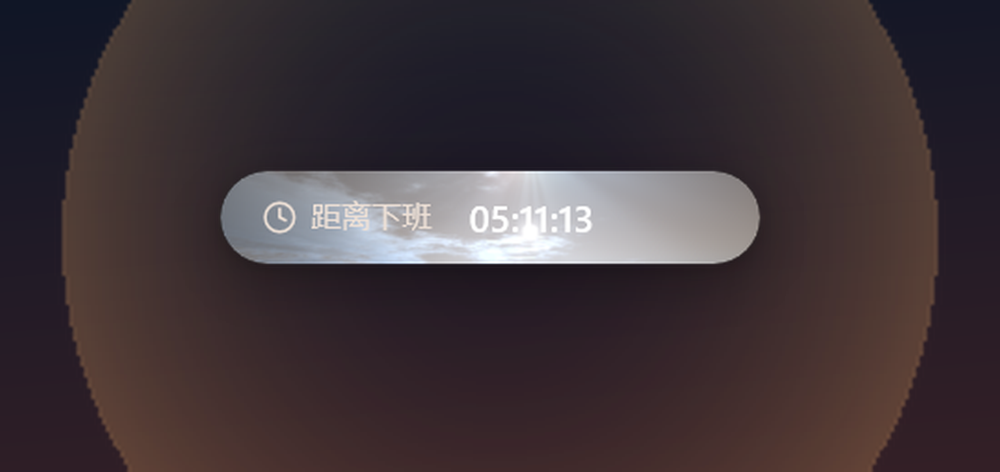
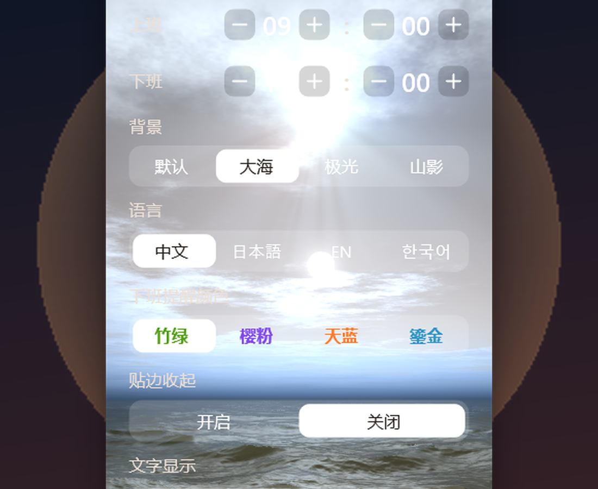
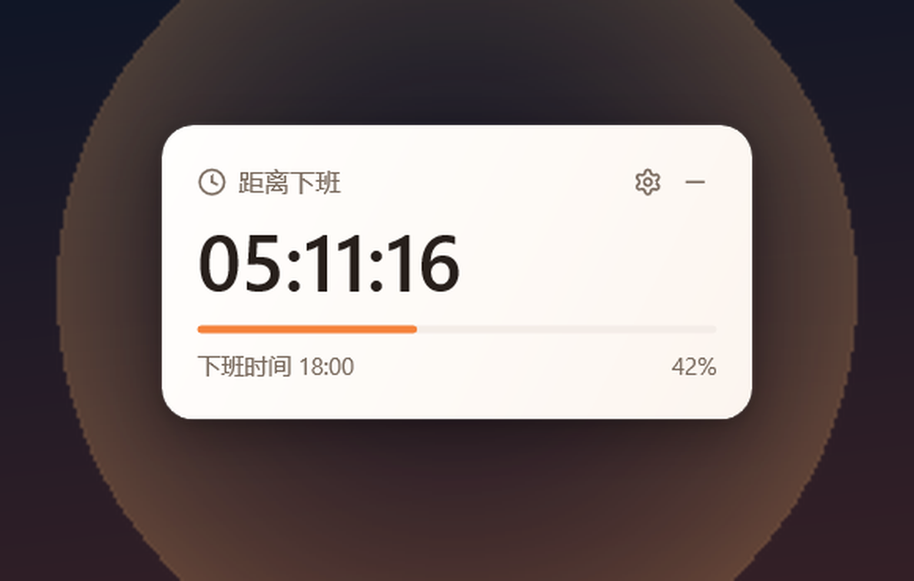
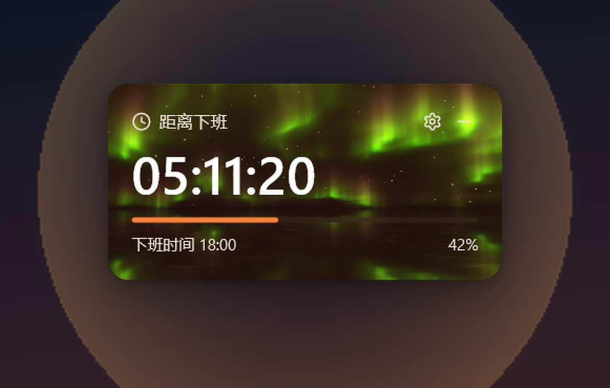
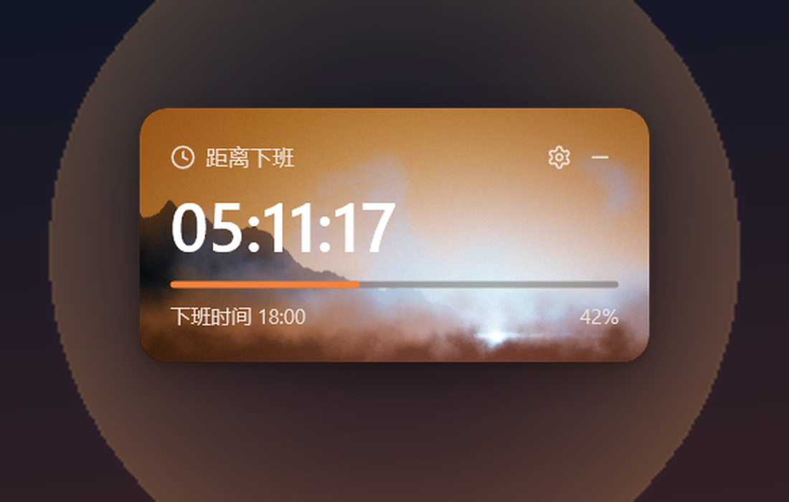

# 下班倒计时

没什么大用，但简单，也漂亮。

一个挂在 Windows 桌面上的倒计时。打开就能看见离下班还有多久。单文件，不用安装。

[下载 2.0](https://offwork.guyu23.xyz) · [GitHub Release](https://github.com/Guyu23/offwork-countdown/releases/latest)

<p align="center">
  
</p>

拖到屏幕边上，会自己藏起来。也可以收成一条。

<p align="center">
  
</p>

点右上角的齿轮，改上下班时间、背景和语言。

<p align="center">
  
</p>

## 四种背景

默认、大海、极光、山影。

<p align="center">
  
  
</p>
<p align="center">
  
  
</p>

## 使用

下载 `OffWorkCountdown.exe`，双击打开。默认上班 09:00，下班 18:00。

设置保存在 `%APPDATA%\OffWorkCountdown\schedule.txt`。

需要 Windows 10 或 11，64 位。

## 构建

Rust + Win32 + Direct3D 11，没有 .NET，也没有 WebView。需要 `x86_64-pc-windows-gnu` 工具链。链接器写在 [`.cargo/config.toml`](.cargo/config.toml)。

```powershell
cargo +stable-x86_64-pc-windows-gnu build --release
```

海洋着色器来自 Shadertoy，源文件在 [`shader-src/Image.txt`](shader-src/Image.txt)，用 [`tools/convert-shader`](tools/convert-shader) 生成 [`src/ocean.hlsl`](src/ocean.hlsl)。不要手改生成结果。
