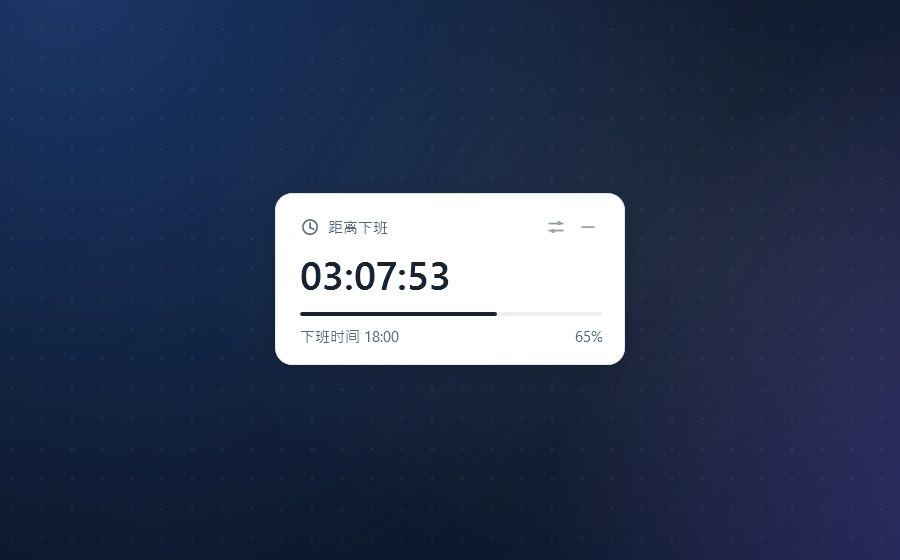

# 下班倒计时（OffWorkCountdown）

一个常驻 Windows 桌面右上角的极简倒计时挂件。原生 WPF 实现，单文件 exe，不依赖 Electron / Tauri / WebView2。

A tiny always-on-top countdown widget for the Windows desktop.



## 功能

- 始终置顶，实时显示距离下班还有多久；到点自动切换为“已下班 / 今天辛苦了”。
- 点右上角收起成小胶囊，再点胶囊展开。
- 可拖动位置并自动记忆；拖到屏幕工作区任意一边附近会自动贴边隐藏，只留 6px，鼠标碰边滑出，移开自动缩回。
- 点右上角设置图标修改上下班时间，保存立即生效；默认 `09:00 / 18:30`。
- 无任务栏按钮，关闭后缩到系统托盘；双击托盘图标显示。
- 支持多显示器和不同缩放比例，配置保存在 `%APPDATA%\OffWorkCountdown\settings.json`。

## 下载

到 [Releases](https://github.com/Guyu23/offwork-countdown/releases/latest) 下载 `OffWorkCountdown.exe`，双击运行。

- 支持 Windows 10 / 11，系统自带 .NET Framework 4.8，不需要额外安装运行时。
- 无需管理员权限，也不需要其他文件。
- exe 未签名，首次运行如果被 SmartScreen 拦住，点“更多信息 → 仍要运行”即可。

## 截图

| 设置 | 收起 |
| --- | --- |
|  |  |

## 构建

系统需要 Windows 10/11 自带的 .NET Framework 4.8 编译器。

```powershell
.\build.ps1
```

构建脚本使用 `C:\Windows\Microsoft.NET\Framework64\v4.0.30319\csc.exe` 直接编译，不需要 Visual Studio 或 .NET SDK。源代码只有 [`src/Program.cs`](src/Program.cs)，方便继续改尺寸、配色和文案。
