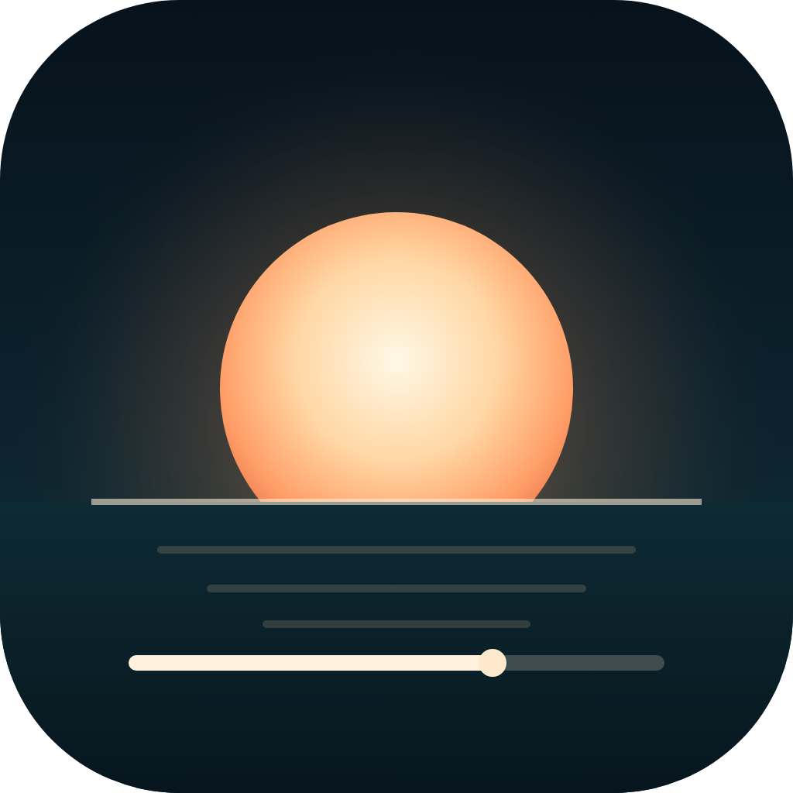
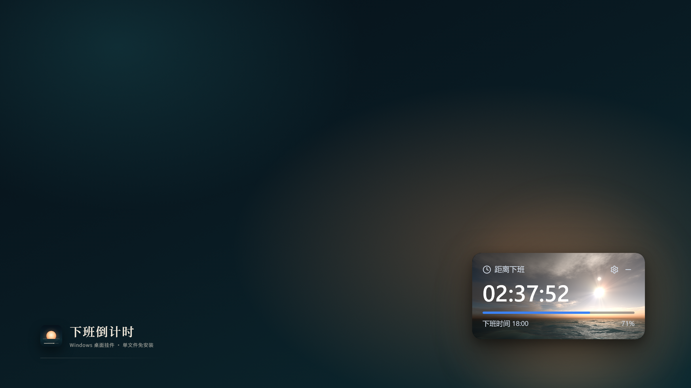
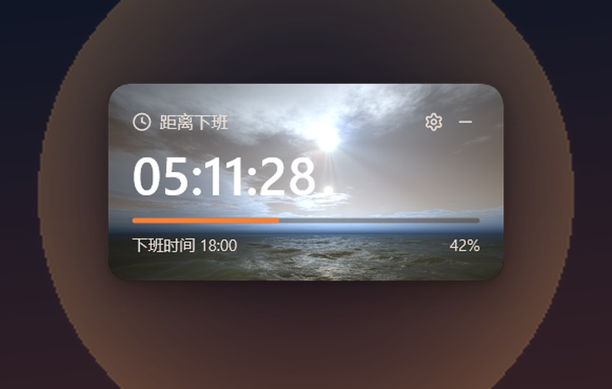
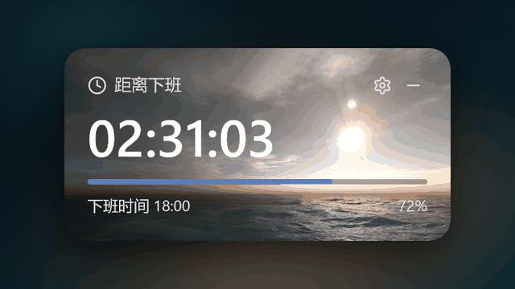
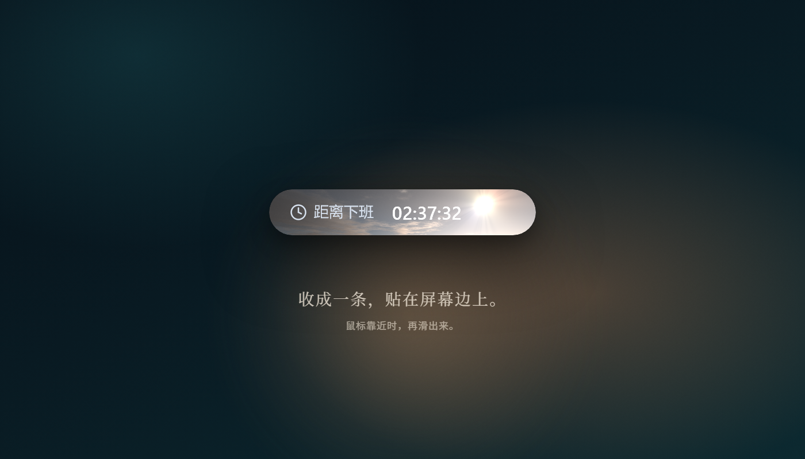
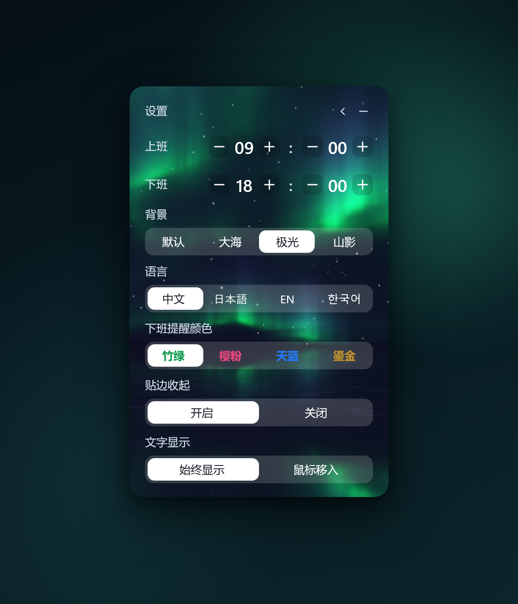
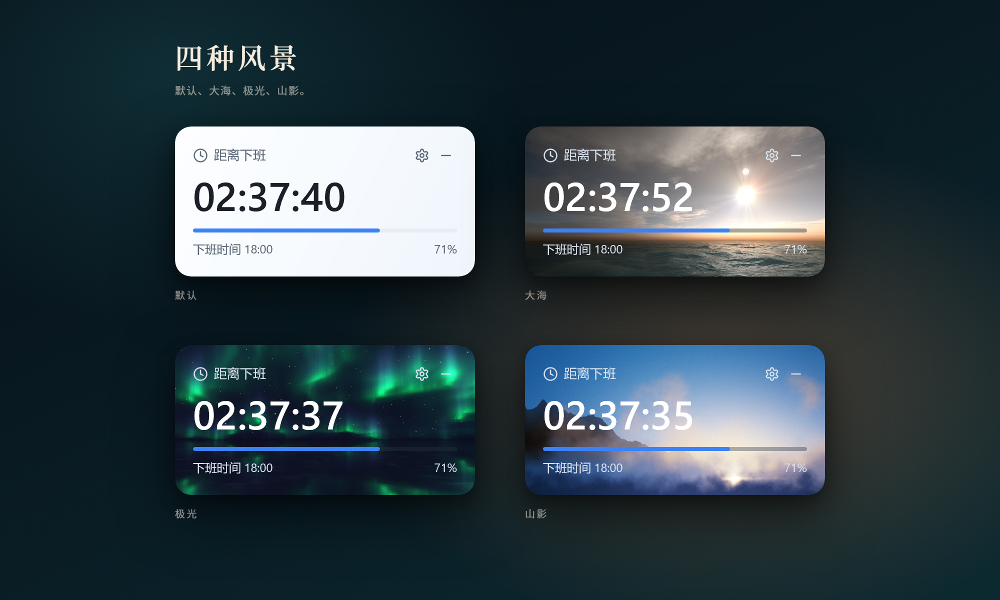
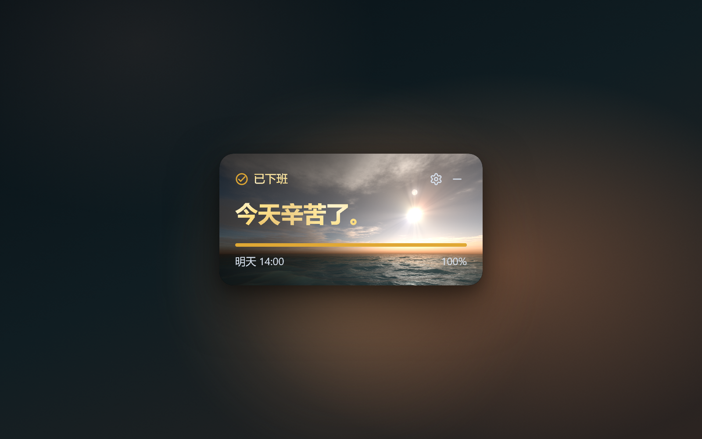

<p align="center">
  
</p>

<h1 align="center">下班倒计时</h1>

<p align="center">离下班，还有一点好时光。</p>

<p align="center">
一个安静的 Windows 桌面倒计时。单文件，免安装。没有账号，没有推送，只有一段时间。
</p>

<p align="center">
  <a href="https://github.com/Guyu23/offwork-countdown/releases/latest"><strong>GitHub 下载</strong></a>
  &nbsp;&nbsp;|&nbsp;&nbsp;
  <a href="https://offwork.guyu23.xyz/download/OffWorkCountdown.exe"><strong>国内镜像</strong></a>
  &nbsp;&nbsp;|&nbsp;&nbsp;
  <a href="https://offwork.guyu23.xyz/">发布页</a>
</p>

<p align="center">Windows 10 / 11　64 位　约 1.3 MB　免安装</p>

<p align="center">
  
</p>

## 它是什么

一个挂在 Windows 桌面上的倒计时。打开就能看见离下班还有多久。

默认上班 09:00，下班 18:00。时间可以改，背景可以换，别的就没有了。

## 看一眼

大海主题下的卡片。时间、进度和下班时间，都在一张卡片里。

<p align="center">
  
</p>

## 它只做几件小事

- 大号数字，抬眼就能看见还剩多久。
- 拖到屏幕边缘会收成一条，鼠标靠近再滑出来。
- 也可以收成一条胶囊，安静地待在角落。
- 四种背景：默认、大海、极光、山影。
- 四种语言：中文、日本語、EN、한국어。
- 到点了，数字换成一句「今天辛苦了」。
- 单文件，免安装，不联网。

<p align="center">
  
</p>

<p align="center">
  
</p>

## 设置

点右上角的齿轮，改上下班时间、背景、语言和下班提醒色。设置只存在本机。

<p align="center">
  
</p>

## 四种背景

默认、大海、极光、山影。

<p align="center">
  
</p>

## 下班那一刻

没有弹窗，也没有提示音。数字停下来，换一句话。

<p align="center">
  
</p>

## 下载

| 来源 | 地址 | 适合 |
| --- | --- | --- |
| GitHub Release | [releases/latest](https://github.com/Guyu23/offwork-countdown/releases/latest) | 能正常访问 GitHub 的网络 |
| 国内镜像 | [OffWorkCountdown.exe](https://offwork.guyu23.xyz/download/OffWorkCountdown.exe) | 国内网络，Cloudflare 加速 |
| 发布页 | [offwork.guyu23.xyz](https://offwork.guyu23.xyz/) | 截图、功能介绍和两个下载入口 |

当前版本：**v2.1.0**。Windows 10 / 11，64 位。

第一次运行如果遇到 SmartScreen 提示，点「更多信息」再点「仍要运行」。程序没有代码签名；源码就在这个仓库里，也可以自己构建。

SHA256：

```text
d3082d404981630f5bad8ddee8377d510de917f8c85bb896990f126a74f548f9
```

## 使用

下载 `OffWorkCountdown.exe`，双击打开。

- 默认上班 09:00，下班 18:00。
- 拖到屏幕边缘，会贴边收起；鼠标靠近再出来。
- 点右上角的齿轮，改时间、背景、语言和提醒色。
- 设置保存在 `%APPDATA%\OffWorkCountdown\schedule.txt`。
- 没有安装程序，也没有开机自启；删掉 exe 就干净了。
- 程序没有联网功能，设置只存在本机。

## 构建

Rust + Win32 + Direct3D 11，没有 .NET，也没有 WebView。

需要 `x86_64-pc-windows-gnu` 工具链。链接器写在 [`.cargo/config.toml`](.cargo/config.toml)，指向本机的 MinGW。

```powershell
cargo +stable-x86_64-pc-windows-gnu build --release
```

图标源文件是 [`assets/offwork-icon.svg`](assets/offwork-icon.svg)，生成的 `.ico` 由 [`build.rs`](build.rs) 嵌入 exe。发布页在 [`docs/`](docs/)，小红书图集在 [`marketing/xiaohongshu/`](marketing/xiaohongshu/)。

## 关于

海洋着色器来自 Shadertoy，源文件在 [`shader-src/Image.txt`](shader-src/Image.txt)，用 [`tools/convert-shader`](tools/convert-shader) 生成 [`src/ocean.hlsl`](src/ocean.hlsl)。字体是 Noto Sans 的子集，生成脚本在 [`tools/subset-fonts.py`](tools/subset-fonts.py)。

截图是用程序真实的 2x 渲染拍摄的，不是画的界面。

## 本次更新

- 重新设计了应用图标：落日、海面、一条倒计时进度。
- 重拍了主界面、设置、四种背景、胶囊和下班状态的截图。
- 新增动态预览 GIF。
- 重写了这篇 README。
- 新增发布页和小红书宣传图。
