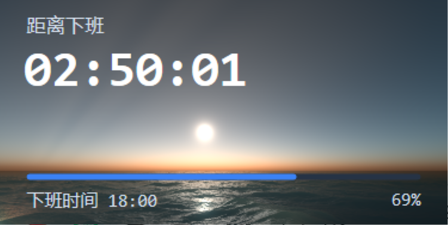

# OffWorkCountdown — native shell (M0.1)

The next version of the widget: **Rust + Win32 + Direct3D 11 + Direct2D + DirectWrite**,
no .NET, no WebView2, no UI toolkit. The window, the shader background and the
card are drawn by hand; everything the OS does not ship is in the executable.



## Build and run

Needs the `x86_64-pc-windows-gnu` toolchain and MinGW (the same setup the GPUI
version used; the crate's [`.cargo/config.toml`](.cargo/config.toml) points the
linker at `D:/Software/mingw/mingw64`).

```powershell
cd native
cargo +stable-x86_64-pc-windows-gnu build --release
.\target\release\offwork-countdown-native.exe
```

## Measured

| | M0.1 | WPF | GPUI | nsh |
| --- | --- | --- | --- | --- |
| executable | **1.03 MB** (two textures embedded) | 1.8 MB | 33.6 MB | 48.6 MB |
| working set | **58 MB** | 141 MB | 81 MB | 203 MB |
| CPU, idle animation | **2.8 % of one core** | — | — | — |

58 MB is D3D11 + D2D + DirectWrite + DWM surfaces, the two channel textures and
quarter of nsh; cutting it further means rendering on demand (nothing but the
shader animates, and the clock changes once a second).

## The data flow

```
HLSL pixel shader ──▶ scene texture (BGRA8, D3D11 default usage)
                          │  ID2D1Bitmap1 from the DXGI surface
                          ▼
                    Direct2D device context ── rounded clipping, blur, colour
                          │                     filters, the panel, DirectWrite
                          ▼
                    swap chain back buffer ──▶ Present
```

The shader owns its own texture rather than the back buffer, so the card has the
background picture to work with: a frosted panel is a Gaussian blur of that
bitmap (`ID2D1Effect`, `CLSID_D2D1GaussianBlur` — verified available on this
machine), and rounded corners are a geometric mask over the same bitmap. All of
it happens inside the app; the desktop behind the window is a separate problem
(DWM acrylic or a screen capture) and is not what those effects touch.

The frame is paced by the loop, not by vsync: `Present(0, …)` plus a ~24 ms
sleep, about 30 frames a second, because only the background moves.

## The ocean background

The card's background is the **complete** Shadertoy pass, not the reduced one the
WPF build used: `shader-src/Image.txt` is the original 2512-line GLSL `Image`
channel, and [`tools/convert-shader`](tools/convert-shader) turns it into
`src/ocean.hlsl` (2577 lines) — a mechanical, re-runnable conversion rather than
a hand port.

```powershell
cargo run --release --manifest-path native/tools/convert-shader/Cargo.toml
```

naga was the obvious tool and does not work here: its GLSL front end has no
opaque types at all (`front/glsl/parser/types.rs` mentions no sampler), so it
cannot parse `uniform sampler2D`. The converter therefore spells the differences
out, and the ones that bit:

| GLSL | HLSL | Why |
| --- | --- | --- |
| `mat2(a,b,c,d)`, `mat3(c0,c1,c2)` | `glsl_mat2`/`glsl_mat3` | GLSL matrices are column-major; the helpers take GLSL's arguments so the transpose lives in one place |
| `m * v`, `v * m` | `mul(m, v)`, `mul(v, m)` | twelve products, listed by hand: no regex knows which side of a `*` is a matrix |
| `float3(0.5)` | `(float3)(0.5)` | this compiler rejects the scalar splat written as a constructor |
| global `const float x = 1.` | `static const float x = 1.0` | HLSL reads a global `const` with an initialiser as an external constant |
| `mat2(...)` in a global initialiser | a macro, not a function | HLSL wants constant expressions there, and a call is not one |
| `mix`, `mod`, `fract`, `atan(y,x)` | `lerp`, floor-based helper, `frac`, `atan2` | different names, and `mod` differs in sign |
| `gl_FragCoord` inside helpers | a `static float2` set by the entry point | Shadertoy lets any function read it |
| `c ? a = x : a = y` | `if`/`else` | HLSL's `?:` takes no assignments |
| `fragCoord` | `iResolution.y - position.y` | Shadertoy's origin is the bottom left, Direct3D's the top left — without this the sea is upside down |

The two channels are `assets/Channel0.png` (256×256 value noise) and
`assets/Channel1.jpg` (1024×1024 moon), decoded at runtime with Windows Imaging
Component and uploaded with a full mip chain because the shader samples very
negative levels on purpose. `iChannel2` is the single black texel the source
expects.

Compiling it costs about **970 ms at startup**; moving that to build time is the
obvious next step.

## Two things that cost the most time

1. **The constant buffer packing.** The HLSL cbuffer
   `{ float g_time; float2 g_resolution; float g_mode; }` packs `g_resolution`
   at **offset 4**, not 8: a vector only skips to the next 16-byte register when
   it would *straddle* one. The first Rust `#[repr(C)]` struct put it at 8, so the
   shader read `(0, 375, 188)` and returned pure black — which looks exactly like
   "Direct3D content never reaches the screen". See `Params` in `gfx.rs`.
2. **`ID2D1DeviceContext` has its own DPI, defaulting to 96.** The target and the
   source bitmaps carried 120, but the context still turned 300 DIPs into 300
   pixels, so the card rendered into a corner of the window. `SetDpi` on the
   context is what makes a DIP a DIP.

Reading a pixel back with a staging texture after each stage is what separates a
drawing bug from a composition bug; it is worth keeping in the toolbox.

## The clouds the export cannot draw

The published `Image` pass ships `#define SIMPLE_SUN 1`, and the sky is then
painted by `getAtmosphericScattering()`, an analytic function with no cloud term
at all. The volumetric cloud layer lives in `scatter()` → `densities()` → the
`mie` density, and it only reaches the picture through the full-atmosphere branch.

The branch is dead in this export: setting `SIMPLE_SUN 0` stops the shader from
compiling, because `sun2` is declared inside `#if SIMPLE_SUN` and used outside it
(source lines 2110, 2263, 2276). Declaring it unconditionally and forcing the
branch makes the shader build, and probes then show the cloud layer working —
`h` reaches 7000 m, `fnoise2` peaks at 0.73, `cloud()` at 1.0 — while the final
composite still comes out flat.

With the switches as shipped, probes of the values `scatter()` hands to the
compositor read `scat ≈ 0.9`, `themie ≈ 0.1–0.3`, `raleigh ≈ 0.09–0.19`, and a
picture of `themie` is a smooth band at the horizon with no cloud structure in
it: the analytic sky dominates and the clouds have nowhere to show. So the
shader on the website is not the shader in the export, and the missing clouds are
a property of the copy we have, not of the conversion.

What was tried afterwards, in case someone picks this up again:

* The right shape of the `SIMPLE_SUN` fix is to declare `sun2` as zero in the
  `#else` branch, not to compute the analytic sky unconditionally. With that in
  place the full scattering path builds and looks richer — but still cloudless.
* `ENABLE_DENSE_RAIN` is 1 and `tonemap` is 9, so the cloud densities are on the
  path that runs.
* Probes inside `densities()` show the rain of numbers is fine right up to the
  end: the 5000–8000 m gate is entered for displayed pixels, `fnoise2` peaks at
  0.73, `cloud()` at 1.0 — and yet `cld`, read at the line that folds it into
  `mie`, is below 0.004 everywhere. Something between the gate and the fold
  clears it; that is where to look next.
* Raising the march from 8 steps to 128 changes the sky's brightness, not its
  clouds, so the step size is not the cause on its own.

## Next

- Round corners, drop shadow and DWM acrylic (`DWMWA_WINDOW_CORNER_PREFERENCE`,
  `DWMWA_SYSTEMBACKDROP_TYPE`), plus a header that drags the window instead of
  the whole card.
- The embedded Maple Mono instead of Consolas (`AddFontMemResourceEx` + a
  DirectWrite font collection).
- The settings panel, the compact state, transitions.
- Tray icon, four-edge auto-hide, launch at login, single instance — port the
  Win32 code that used to live in `gpui/src/`.
- Device-lost recovery (`DXGI_ERROR_DEVICE_REMOVED`): build every GPU resource in
  one recreatable function from the start.
- Settings on disk: read and write the WPF version's
  `%APPDATA%\OffWorkCountdown\settings.json`, so the two builds share them.
